# Практическая работа №4
# Имитация спринта с использованием веток GitHub

**ФИО:** Киреев Александр Сергеевич  
**Группа:** М 25-ИО  
**Дата:** 24.10.2026  
**Дисциплина:** Программная инженерия  
**Проект:** MVP интернет-магазина на Python  
**GitHub:** [Reevan8899](https://github.com/Reevan8899)  
**Публичный репозиторий:** [sprint-demo](https://github.com/Reevan8899/sprint-demo)

## 1. Цель и формат выполнения

Пройти цикл учебного спринта: планирование, feature-ветки, Pull Request,
проверка кода, конфликт слияния, релиз, Review и Retrospective.
Работа выполнена индивидуально с согласованным совмещением ролей и самопроверкой.

**Отличие от командного задания:** команды из 4-5 человек, ревью от разных участников
и внешнего approval нет. Три замечания оформлены как самопроверка одного автора с
ответами и тестовыми изменениями. Для индивидуального варианта защита требует PR
и CI, но число обязательных внешних одобрений установлено в 0. Одобрение преподавателем
индивидуального формата и принятие работы не заявляются как состоявшиеся события.

## 2. Роли и распределение фич

| Роль | Исполнитель | Действия |
|---|---|---|
| Product Owner | Киреев А. С. | Цель, истории, приоритеты, критерии приёмки |
| Scrum Master / капитан | Киреев А. С. | Репозиторий, правила веток, порядок интеграции, ретроспектива |
| Developer | Киреев А. С. | Пять модулей, unit- и интеграционные тесты, исправления |
| Самопроверка | Киреев А. С. | Проверка PR по чек-листу; не независимое ревью |

| Фича / feature-ветка | Issue | Pull Request в sprint-1 | Результат |
|---|---|---|---|
| user-auth | [#1](https://github.com/Reevan8899/sprint-demo/issues/1) | [PR #2](https://github.com/Reevan8899/sprint-demo/pull/2) | Squash and merge; выполнено |
| product-catalog | [#3](https://github.com/Reevan8899/sprint-demo/issues/3) | [PR #4](https://github.com/Reevan8899/sprint-demo/pull/4) | Squash and merge; выполнено |
| cart | [#5](https://github.com/Reevan8899/sprint-demo/issues/5) | [PR #6](https://github.com/Reevan8899/sprint-demo/pull/6) | Squash and merge; выполнено |
| checkout | [#7](https://github.com/Reevan8899/sprint-demo/issues/7) | [PR #8](https://github.com/Reevan8899/sprint-demo/pull/8) | Squash and merge; выполнено |
| order-history | [#9](https://github.com/Reevan8899/sprint-demo/issues/9) | [PR #10](https://github.com/Reevan8899/sprint-demo/pull/10) | Squash and merge; выполнено |

Для Issues и PR использованы метки `feature`, `priority: high` и milestone `Sprint 1`.
Описания PR содержат изменения, команды проверки, `Closes #N`, чек-лист и формат работы.

## 3. Sprint Goal и Definition of Done

**Sprint Goal:** реализовать покупку от регистрации и просмотра каталога до корзины,
заказа с адресом доставки и поиска заказа в истории.

Definition of Done индивидуального варианта:

- [x] Код запускается на Python 3.12.
- [x] У каждой фичи есть unit-тесты, включая ошибки и граничные случаи.
- [x] Ruff и pytest проходят; порог покрытия не ниже 80%.
- [x] Самопроверка зафиксирована; замечания сопровождаются тестовыми коммитами.
- [x] Все пять feature PR смержены в sprint-1.
- [x] Документация описывает запуск и ограничения.
- [x] Сквозная демонстрация подтверждает цель спринта.

Фактический результат после hotfix: **74 теста, 100% покрытия строк и ветвлений логики**
(118 исполняемых строк и 50 ветвей).
Консольный адаптер `src/demo.py` исключён из покрытия и проверен отдельным запуском.

## 4. Репозиторий, ветки и реализация

Созданы публичный репозиторий с README, `.gitignore`, MIT-лицензией, ветки `main`,
`sprint-1` и пять `feature/*`. Код и тесты фиксировались отдельными атомарными
коммитами. Структура создана до включения защиты; затем изменения проходили через PR.

```text
sprint-demo/
  src/          auth.py, catalog.py, cart.py, checkout.py, orders.py, demo.py, validation.py
  tests/        unit-тесты, интеграционные и регрессионные тесты
  docs/         цель, Review, Retrospective, отчёт и доказательства
  scripts/      комментарий с покрытием для GitHub Actions
  .github/      шаблон PR и workflows/pr-check.yml
  README.md     запуск и назначение
  requirements.txt, pyproject.toml, LICENSE
```

Цены представлены целыми рублями; количество - положительным целым числом, `bool`
не принимается за ID или количество. Хранилища находятся в памяти процесса.
Каталог, корзина и заказы возвращают независимые копии, чтобы внешний код не менял
состояние через полученную ссылку. После hotfix пароли хешируются PBKDF2-HMAC-SHA256
с 600000 итераций и случайной 16-байтовой солью.

Снимок списка веток до их удаления после слияний:

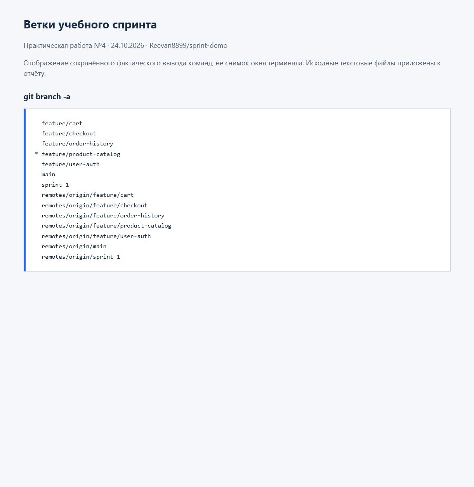

Это снимок страницы с сохранённым реальным выводом команды; не снимок окна терминала.
Исходный вывод: [branches.txt](PR4_assets/branches.txt).

## 5. Pull Request и самопроверка

Одновременно были открыты пять PR, каждый направлен в `sprint-1`:

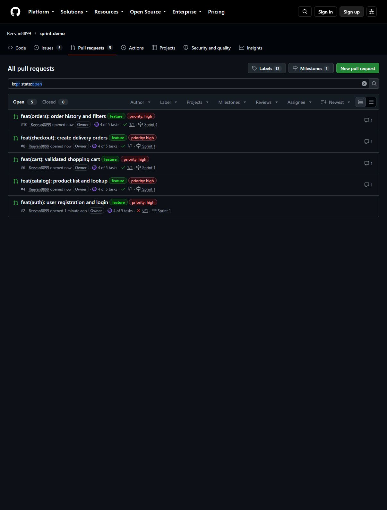

Конструктивные замечания и ответы:

| PR | Замечание | Ответ |
|---|---|---|
| 4 | [Изоляция каталога](https://github.com/Reevan8899/sprint-demo/pull/4#discussion_r4367326233) | [Ответ автора](https://github.com/Reevan8899/sprint-demo/pull/4#discussion_r4367326369) |
| 6 | [Снимки корзины](https://github.com/Reevan8899/sprint-demo/pull/6#discussion_r4367326524) | [Ответ автора](https://github.com/Reevan8899/sprint-demo/pull/6#discussion_r4367326705) |
| 8 | [Проверка адреса](https://github.com/Reevan8899/sprint-demo/pull/8#discussion_r4367326912) | [Ответ автора](https://github.com/Reevan8899/sprint-demo/pull/8#discussion_r4367327093) |

По замечаниям добавлены тесты изменения возвращённых данных каталога/корзины,
входного товара, пустого адреса, пробельного адреса и нормализации адреса.
Обсуждения разрешены после внесения исправлений. Все комментарии и ответы сделаны
одним аккаунтом и помечены как индивидуальная самопроверка.

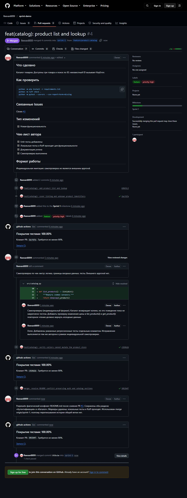

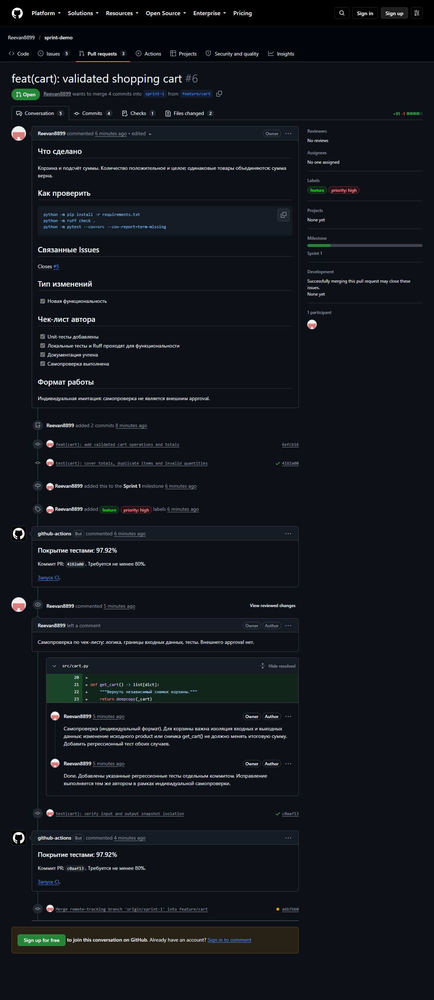

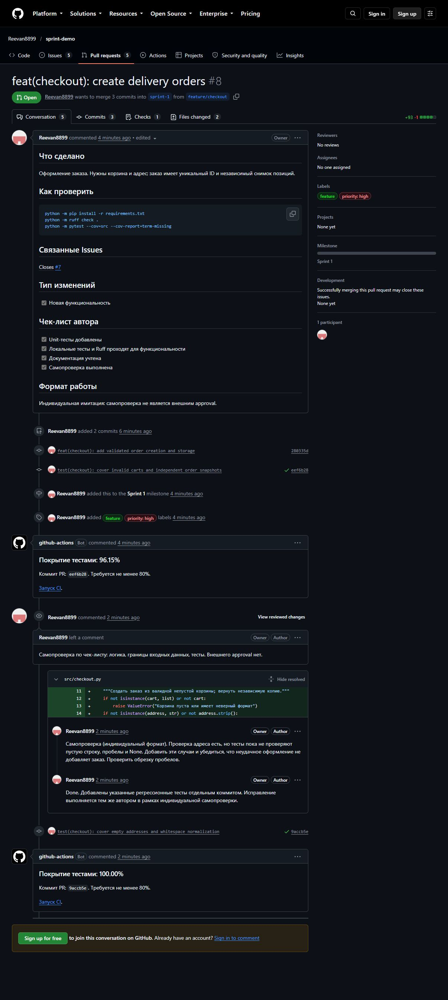

Пять feature PR приняты методом Squash and merge. Перед каждым следующим слиянием
ветка обновлялась из `sprint-1`; локальные проверки и GitHub Actions выполнялись снова.

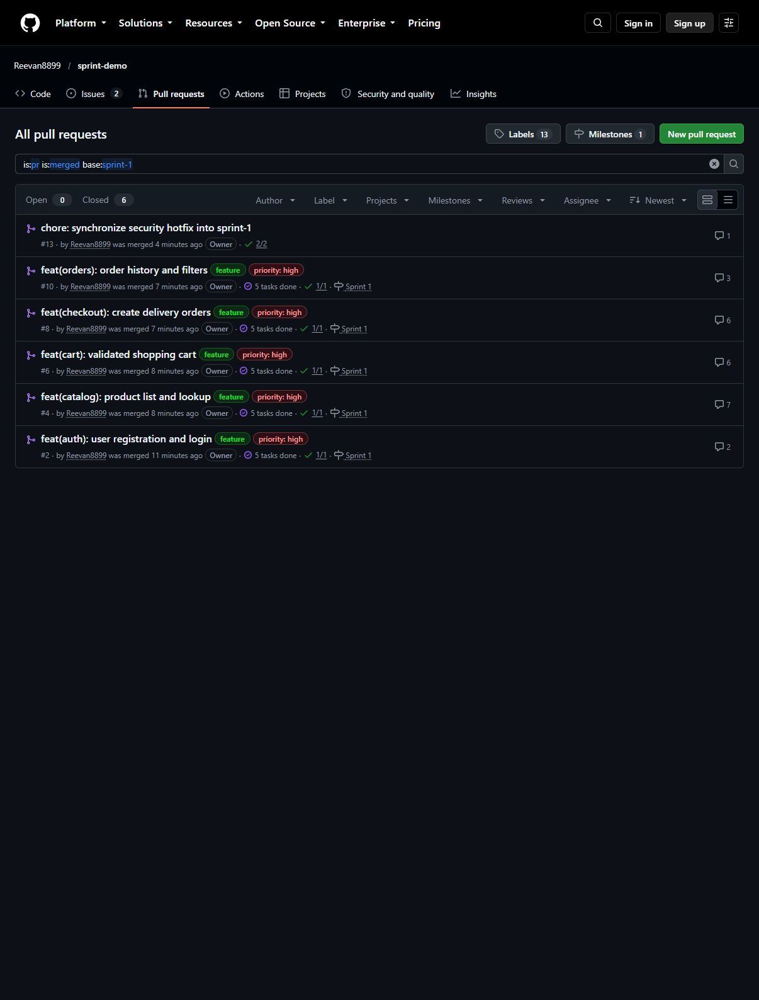

## 6. Конфликт и его разрешение

Auth и catalog были созданы от одной версии `sprint-1` и изменили один блок README.
После слияния auth при `git merge origin/sprint-1` в ветке catalog получен реальный
`CONFLICT (content): Merge conflict in README.md`.

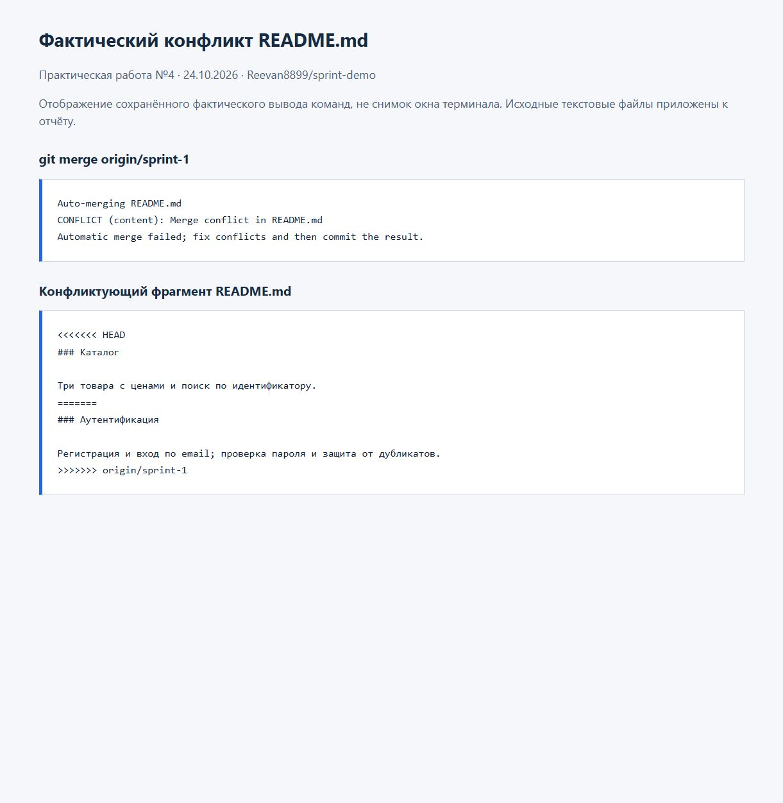

Порядок разрешения:

1. Переключиться в `feature/product-catalog`, получить актуальный `sprint-1`.
2. Выполнить `git merge origin/sprint-1` и изучить обе версии между маркерами.
3. Удалить маркеры, сохранить разделы «Аутентификация» и «Каталог».
4. Добавить README в индекс и создать коммит
   `merge: resolve README conflict preserving auth and catalog sections`.
5. Запустить Ruff и pytest, отправить ветку; дождаться зелёного CI и слить PR #4.

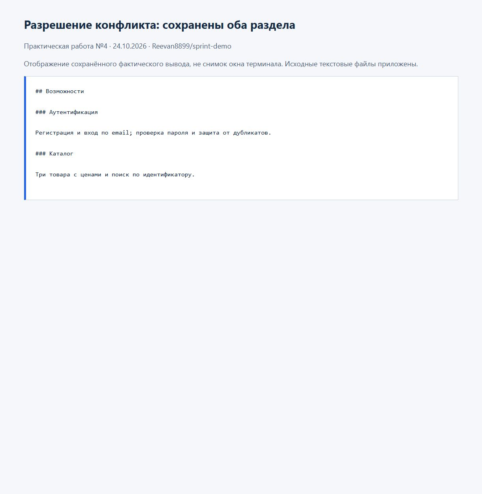

Сохранены [вывод merge](PR4_assets/conflict-command.txt),
[README с конфликтом](PR4_assets/conflict-readme.txt) и
[разрешённый README](PR4_assets/conflict-resolved-readme.txt).
Для снимков конфликта использована страница с фактическим сохранённым выводом,
а не изображение окна терминала. История разрешения также сохранена в PR #4.

## 7. Защита веток и финальный релиз

Для `main` и `sprint-1` включены обязательный PR, проверка `lint-and-tests`,
актуальность ветки относительно базы, разрешение обсуждений, применение правил
к администраторам, запрет force-push и удаления. Внешних approvals требуется 0
по согласованному индивидуальному формату. Настройка dismiss stale reviews включена,
но при отсутствии обязательных approvals не заменяет независимую проверку.
Сохранены фактические ответы API:
[main](PR4_assets/protection-main.json), [sprint-1](PR4_assets/protection-sprint-1.json).

Итоговый [PR #11](https://github.com/Reevan8899/sprint-demo/pull/11) `release: sprint-1 MVP`: `sprint-1 → main` принят merge-коммитом.
Создан аннотированный тег и опубликован [релиз v0.1.0](https://github.com/Reevan8899/sprint-demo/releases/tag/v0.1.0).

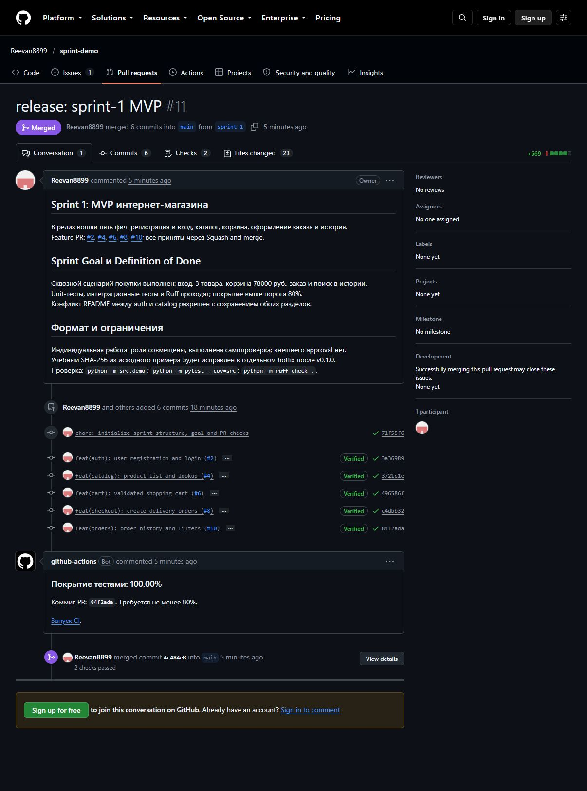

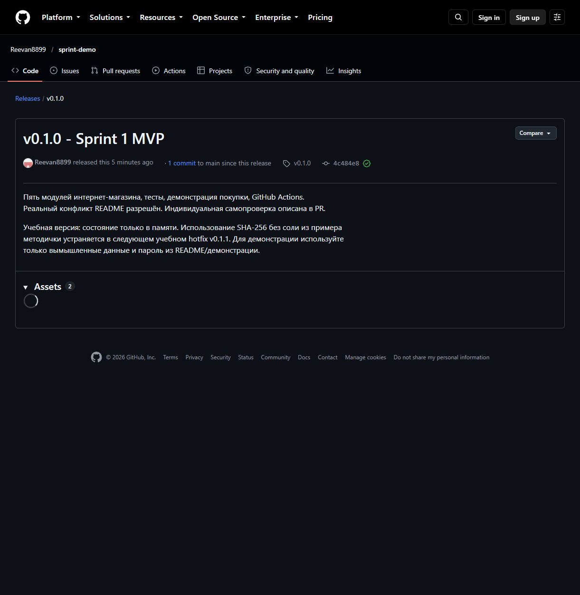

После слияния временные feature-ветки удалены; код и их коммиты доступны через PR.
Ветки `main` и `sprint-1` сохранены. Исправление безопасности присутствует в обеих.

## 8. Sprint Review

Демонстрация выполнена живым запуском `python -m src.demo`, не презентацией.
Автор всех фич - Киреев А. С. Самоприёмка не выдаётся за решение преподавателя.

| Фича | Демонстрация | Замечание самопроверки / дальнейшее развитие | Статус |
|---|---|---|---|
| user-auth | Регистрация и вход успешны | PBKDF2 внедрён в hotfix; далее восстановление пароля | Самопроверка пройдена |
| product-catalog | 3 товара, поиск по ID | Добавить поиск по названию | Самопроверка пройдена |
| cart | Ноутбук + 2 мыши = 78000 руб. | Добавить удаление позиции | Самопроверка пройдена |
| checkout | Создан заказ на 78000 руб. | Перенести хранилище в БД | Самопроверка пройдена |
| order-history | Заказ найден, фильтр вернул 1 результат | Добавить сортировку | Самопроверка пройдена |

```text
1. Вход: True
2. Товаров в каталоге: 3
3. Сумма корзины: 78000 руб.
4. Заказ оформлен: 78000 руб.
5. Заказ найден в истории: True
6. Заказов от 50000 руб.: 1
7. Корзина после оформления: []
```

Sprint Goal достигнут в рамках учебной библиотеки. Обратная связь преподавателя
ещё не получена. Полный протокол находится в `docs/sprint-review-1.md`.

## 9. Retrospective: Start / Stop / Continue

**Continue:** атомарные коммиты, PR перед слиянием, тесты при каждой интеграции,
фиксация доказательств до исправлений.

**Stop:** полагаться только на успешные сценарии и оставлять упрощённое хранение
паролей из примера; считать самопроверку независимым ревью.

**Start:** заранее фиксировать контракты данных и требования безопасности,
назначать внешнего ревьюера для следующего командного спринта.

| Action Item | Ответственный | Срок | Критерий / статус |
|---|---|---|---|
| Закрыть пробелы тестов по 3 замечаниям | Киреев А. С. | Sprint 1 | Тесты добавлены, обсуждения закрыты; выполнено |
| Обязательные PR и CI в обеих ветках | Киреев А. С. (SM) | Sprint 1 | Отказ GitHub на падающий CI получен; выполнено |
| Hotfix хеширования и перенос в спринт | Киреев А. С. (Dev) | После v0.1.0 | v0.1.1 и PR #13; выполнено |
| Внешний ревьюер для командного спринта | Киреев А. С. (SM) | До первого PR Sprint 2 | Approval другого участника; запланировано |
| User Stories для БД и поиска | Киреев А. С. (PO) | Планирование Sprint 2 | Приёмочные критерии; запланировано |

Полный протокол находится в `docs/retro-sprint-1.md`.

## 10. Дополнительное задание B: GitHub Actions

Созданы `.github/workflows/pr-check.yml` и `scripts/coverage_comment.py`.
Workflow запускается на PR в `sprint-1` и `main`, устанавливает зависимости,
запускает Ruff и pytest с покрытием; бот публикует результат в комментарии PR.
Порог покрытия - 80%, в README добавлен бейдж CI.

В PR #2 временно добавлен `test_ci_failure_demonstration` с `assert False`.
Проверка упала, состояние PR стало `blocked`. Попытка слияния через API отклонена:

```text
HTTP 405: Required status check "lint-and-tests" is failing.
```

После сохранения доказательств падающий тест удалён отдельным коммитом, CI прошёл,
PR слит обычным способом. Сбой не скрыт переписыванием истории.

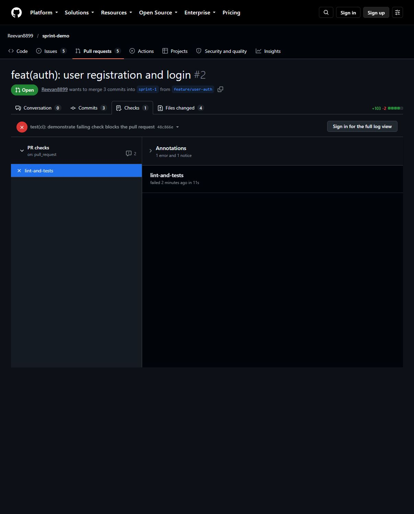

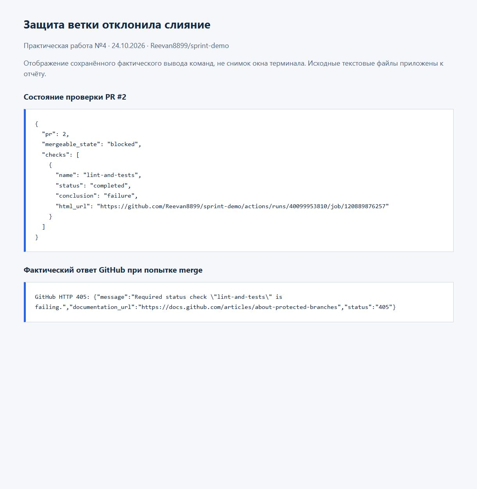

Ссылки: [упавший запуск](https://github.com/Reevan8899/sprint-demo/actions/runs/40099953810),
[состояние CI](PR4_assets/ci-failure.json), [ответ GitHub](PR4_assets/blocked-merge.txt).
Комментарии github-actions с покрытием видны на снимках PR в разделе 5.

## 11. Дополнительное задание D: hotfix после релиза

После `v0.1.0` создана ветка `hotfix/security-patch` от `main`.
Регрессионный тест показал недостаток SHA-256 без соли из первоначального учебного
примера: одинаковые пароли двух пользователей имели одинаковый хеш.
[Вывод теста до исправления](PR4_assets/hotfix-before.txt).

Внедрены PBKDF2-HMAC-SHA256, соль 16 байт, 600000 итераций и безопасное сравнение.
Добавлены тесты случайной соли, входа и повреждённого формата хеша.
[PR #12](https://github.com/Reevan8899/sprint-demo/pull/12) направлен в `main`, помечен `priority: high`, прошёл CI и смержен.
Созданы тег и [релиз v0.1.1](https://github.com/Reevan8899/sprint-demo/releases/tag/v0.1.1). Затем [PR #13](https://github.com/Reevan8899/sprint-demo/pull/13) `main → sprint-1`
перенёс исправление и тесты в спринт. Это учебный hotfix; реальная эксплуатация
и инцидент с пользовательскими данными не заявляются.

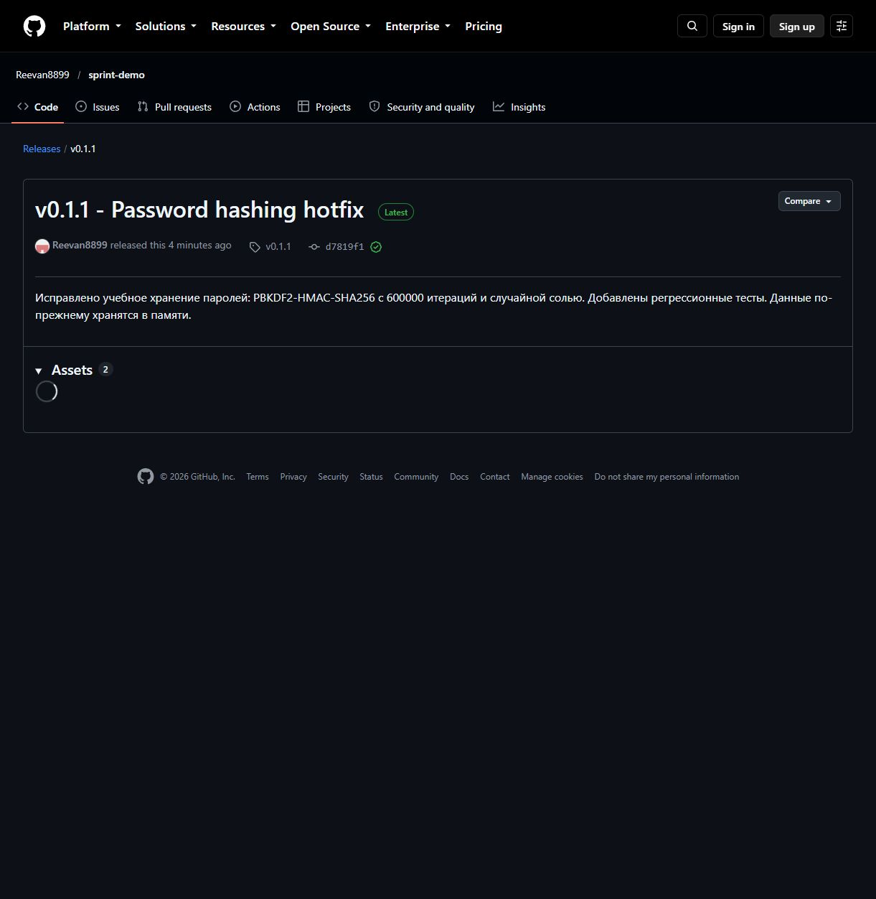

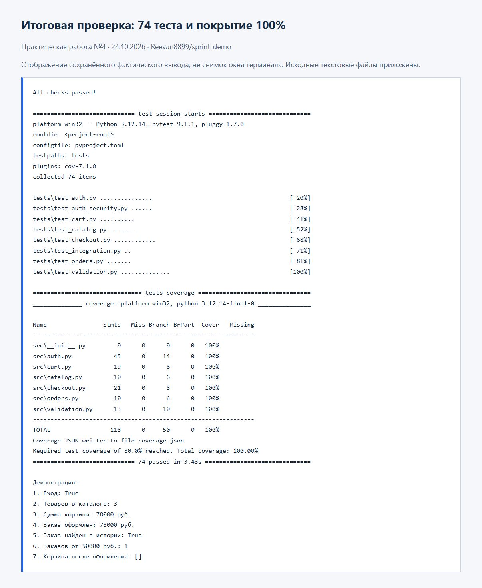

## 12. Ответы на контрольные вопросы

### 1. Почему feature-ветку создают от sprint-1, а не от main?

Она получает основу текущего спринта, включая уже интегрированные изменения.
Фича разрабатывается для sprint-1, а main содержит стабильный релиз. Ветка от
устаревшего main может не содержать новых контрактов зависимых модулей.

### 2. В чём разница между git merge и git rebase?

Merge объединяет линии истории, сохраняя существующие коммиты; при расхождении
обычно создаёт merge-коммит. Rebase заново применяет коммиты ветки на другой базе,
меняя их SHA и делая историю линейной. Опубликованную общую ветку нельзя без
согласования переписывать rebase: это нарушит историю коллег. В конфликте README
использован merge, поэтому force-push не понадобился.

### 3. Что такое Squash and merge и почему он рекомендуется?

Все изменения PR становятся одним новым коммитом в целевой ветке. В sprint-1
получается понятная история «одна фича - один коммит» и упрощается откат фичи.
Внутренние рабочие коммиты остаются доступными в PR, но не становятся отдельными
коммитами целевой ветки. Обычный merge удобен для синхронизации долгоживущих веток.

### 4. Что произойдёт, если два PR изменяют одну строку кода?

После первого слияния второй может получить конфликт, если Git не может совместить
изменения автоматически. Второму автору нужно обновить ветку и согласовать смысл
обеих правок. Изменение одинаковой строки не гарантирует конфликт: одинаковые
правки Git иногда объединяет автоматически.

### 5. Как разрешить конфликт слияния? Пошагово.

Получить актуальную базу через fetch; переключиться в feature-ветку; выполнить
merge базы; посмотреть `git status`; изучить конфликтующие файлы; выбрать
корректный совместный результат и удалить маркеры; запустить проверки; добавить
файлы через add; завершить merge коммитом; отправить ветку и дождаться CI.
При rebase вместо merge-коммита используется `git rebase --continue`; для отмены
можно применить соответствующий `--abort`. После разрешения проверить бизнес-смысл,
а не только отсутствие маркеров.

### 6. Зачем нужна Branch Protection и какие правила полезны?

Она технически ограничивает случайные прямые push и неготовые слияния. Полезны
обязательный PR, approval коллеги, сброс устаревших approvals, обязательные проверки,
разрешённые обсуждения, применение к администраторам и запрет force-push/удаления.
В этой индивидуальной работе обязательное внешнее approval отключено явно;
остальные перечисленные применимые ограничения включены. Отказ CI проверен опытом.

### 7. Что проверяет код-ревьюер? Что не должен проверять?

Проверяет соответствие задаче, корректность, границы, безопасность, читаемость,
архитектуру, тесты и существенные проблемы производительности. Не оценивает
личность автора и не навязывает личный стиль вопреки правилам проекта.
Автоматическое форматирование и типовые нарушения стиля лучше поручить линтеру;
ревьюер оценивает те свойства, которые автоматические проверки не доказывают.

### 8. Как конструктивно оставить комментарий в PR?

Указать конкретную строку, наблюдаемую проблему, её последствия и проверяемое
предложение. Например: «Добавить тест изменения снимка get_cart(): внешнее
изменение количества не должно менять сумму корзины». Разделять обязательную
ошибку и необязательное улучшение; обсуждать код уважительно, без оценки автора.

### 9. Что такое Definition of Done? Приведите пример.

Это единые критерии готовности Increment, согласованные до работы. Пример:
код работает, есть тесты ошибок и успеха, CI и линтер проходят, выполнено ревью,
PR смержен и документация обновлена. «Готово» нельзя определять только наличием кода.
Для индивидуального варианта в отчёте явно указана замена внешнего ревью самопроверкой.

### 10. Зачем проводить Retrospective? Чем она отличается от Sprint Review?

Review рассматривает продукт: демонстрируется Increment, собирается обратная связь
стейкхолдеров и уточняется дальнейшая работа. Retrospective рассматривает способ
работы: взаимодействие, инструменты, затруднения и конкретные улучшения процесса
с ответственными и критериями. В индивидуальном выполнении записаны демонстрация
и собственная рефлексия; внешняя обратная связь не выдумывается.

## 13. Трудности и решения

| Трудность | Решение и подтверждение |
|---|---|
| Один исполнитель вместо команды | Явное совмещение ролей; согласованный индивидуальный формат; без вымышленных одобрений |
| Падающий CI запрещает merge | Зафиксирован HTTP 405; тест-демонстрация удалён отдельным коммитом; проверка стала зелёной |
| Два раздела претендуют на один блок README | Сохранены оба раздела и создан коммит разрешения конфликта |
| После слияния база следующего PR меняется | Feature-ветка обновляется из sprint-1; CI и локальные проверки повторяются |
| Недостаточно граничных тестов | По трём замечаниям добавлены проверки копий и адресов |
| Упрощённый хеш из примера | Регрессионный тест, PBKDF2 hotfix, v0.1.1 и обратная синхронизация |

## 14. Что предъявить на защите

1. Публичный репозиторий, пять feature PR и три обсуждения самопроверки.
2. Историю конфликта README и отказа CI, защищённые main/sprint-1.
3. Релизы v0.1.0 и v0.1.1, hotfix PR и синхронизацию.
4. Живой запуск `python -m src.demo` и `python -m pytest --cov=src`.
5. Этот отчёт, протоколы Review/Retrospective и два дополнительных задания B и D.

**Ограничения:** проект учебный, данные хранятся только в памяти; многопользовательский
сервер, платежи, БД и реальные персональные данные в объём спринта не входят.
Командные критерии о разных участниках и внешних approvals не выполнены и явно
отделены от фактической индивидуальной работы.

## Источники

- Предоставленная методичка: «Практическая работа №4. Имитация спринта с использованием веток GitHub», 34 страницы.
- [GitHub: обязательные ревью и запрет собственного approval](https://docs.github.com/en/pull-requests/how-tos/review-pull-requests/approving-a-pull-request-with-required-reviews).
- [GitHub: защита веток](https://docs.github.com/en/repositories/configuring-branches-and-merges-in-your-repository/managing-protected-branches/about-protected-branches).
- [GitHub Actions: синтаксис workflow](https://docs.github.com/en/actions/reference/workflows-and-actions/workflow-syntax).
- [actions/checkout](https://github.com/actions/checkout) и [actions/setup-python](https://github.com/actions/setup-python).
